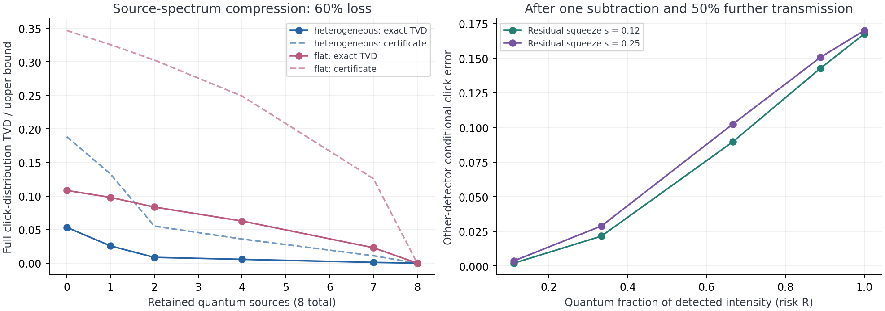

# GBS algorithm opportunities and validation

**Date:** October 11, 2026. **Status:** literature search and exploratory mechanism tests completed; no new complete sampler has been shown to outperform a published sampler. This note prioritizes algorithm development while preserving the independent reproduction/stress-test work in [[GBS Classical Simulation Project Description]] and the existing grant specification.

## Recommendation

The strongest prospective algorithm proposal is **adaptive preservation of detection-induced non-Gaussianity**: use a cheap Gaussian description for most of a lossy simulation, but retain a small, exact non-Gaussian component after the detections where replacing it by a Gaussian causes substantial error. The intended niche is accurate threshold-click sampling at finite brightness and 50%–70% total photon loss, where a fast approximation can miss conditional detector correlations.

There is a concrete physical mechanism behind this recommendation. Our two-mode test found that a Gaussian reset after a photon subtraction can change another detector's conditional click probability from 0.5072 to 0.3397. The same local discrepancy becomes small when the classical displacement is large. A trigger can therefore spend expensive work on the events most likely to lose important information. This is a conditional primitive test, not a completed sampling algorithm or a hardware result.

The second option is **error-budgeted compression of the quantum source spectrum**, aimed at systems with a few strong and many weak residual squeezed sources. It has a clean error bound and favorable complete-distribution tests, but substantial prior overlap means it needs a distinctive sampling implementation to become an original algorithm paper. The third is **choosing Gaussian decompositions for actual sampling cost rather than quantum photon number alone**. It has an exact structured example and potentially broad benefit, but optimizing entanglement over Gaussian decompositions is already an established subject.

These are reasonable subjects for a proposal to develop and test a method. The current evidence does **not** support a probability such as “90% likely to beat Goodman,” a guaranteed publication, or a new general scaling theorem. Ranking potential impact separately from demonstrated evidence prevents a large speculative idea from displacing a smaller useful result.

## What was searched and what changed the search

The search covered the established exact-sampling algorithms and the recent approximate families, then tested overlap queries for source rank, source truncation, sparse/next-click sampling, conditional Gaussian resets, stellar rank, quantum/classical decomposition, cumulants, low connectivity, rare-event conditioning, gradients, quasi-Monte Carlo, control variates, detector fan-out, and non-Gaussian resource-state simulation. Relevant primary papers, supplements, and official software documentation were inspected. Exact-phrase searches for the proposed combinations did not establish a prior identical implementation; absence of a search hit is not proof of novelty. This is a dated search, not an exhaustive survey of unpublished work.

An important discovery was [Lim's October 5, 2026 preprint][lim]. It already introduces covariance-matched resets after fictitious photon absorptions, source-space reduction, and polynomial expected arithmetic cost. It reports a worst-case $O(N\eta^3)$ error scaling and an equal-squeezing pair construction reaching a different asymptotic regime. Its explicit uniform error bound is uninformative at our transmission range $\eta=0.3$–$0.5$; its small numerical examples and a displaced variant provide motivation, not a performance guarantee here. We therefore exclude “invent photon trajectories,” “use source rank,” and “reset to a Gaussian” as standalone novelty claims. Our proposed extension concerns selectively retaining the non-Gaussian conditional state.

The search also found [Kalra and Kocharovsky's June 2026 analysis][core] of the active sector of the minimum-trace quantum covariance problem. Generic active-sector compression is consequently another existing ingredient. [Liu et al.][pco] already avoid hafnians when constructing Gaussian MPS tensors. A proposal cannot claim that removing hafnians from MPS preparation is new.

### Relevant approaches and the tasks they address

| Approach | Mechanism and principal task | Boundary relevant to this search |
| --- | --- | --- |
| [Goodman et al.][goodman] | Project positive-P variables into detector probabilities and apply iterative whitening/coloring; approximate detector-record generation and experimental benchmark comparisons. | Projected records introduce approximation bias; calculating accurate phase-space observables alone does not produce exact records. |
| [Oh et al.][oh] | Split a lossy state into a smaller pure quantum component plus classical displacement noise; simulate the component with an MPS. | Cost depends on quantum correlations, cutoffs, bond dimension, and sample generation, not just the output photon count. |
| [Dodd et al.][dodd] | Approximate sequential click probabilities using a truncated cumulant expansion. | High-order information storage grows with mode count; brightness and truncation reliability matter. |
| [Liu et al.][pco] | Gaussian SVD and projected creation operators accelerate low-entanglement Gaussian-to-MPS construction. | Improved preparation is not a measured improvement of the entire sampling pipeline. |
| [Lim][lim] | Conditional covariance evolution and approximate photon-detection resets. | A complete trajectory bound at the chosen finite loss/brightness is needed for any extension. |
| [Drummond et al.][matrixp] | Symmetry-adapted matrix phase space reduces errors in count-probability estimation. | This targets validation observables; it does not automatically generate individual quantum detector records. |
| [Oh et al.][treewidth] and [Kolarovszki et al.][sparse] | Exploit circuit connectivity or long zero runs in suitably structured threshold circuits. | These properties are generally absent in a deep dense Haar interferometer. |
| [Quesada et al.][exact] and [Bulmer et al.][boundary] | Exact chain-rule sampling and auxiliary conditioning, including detector-specific improvements. | These are required exact/specialized competitors; a naive dense calculation is insufficient as a competitive baseline. |

## Decision matrix

Scores are judgments on a **1–5** scale, not probabilities of success. Impact means impact *if the proposed implementation succeeds*. Evidence 4 means an exact kernel or complete small-distribution test here; evidence 3 means a local mechanism or covariance test; evidence 2 means partial evidence or an implementation obstacle. Evidence 5 would require a matched end-to-end win over strong published competitors; **no option earns 5**. Feasibility rates the next local prototype. Novelty 3 means a specific provisional gap, 2 means substantial overlap, and 1 means the mechanism is already explicit in prior work. No candidate has fully cleared novelty.

The priority score is $0.30I+0.30E+0.20F+0.20N$. Originality and task-fit gates apply in addition to this score; a fast existing kernel is useful infrastructure but cannot lead an original-method proposal by itself. The ordering below prioritizes proposal candidates and their niches, rather than presenting all scores as one universal league table.

| Priority | Candidate | Impact $I$ | Evidence $E$ | Feasibility $F$ | Novelty $N$ | Score | Decision |
| ---: | --- | ---: | ---: | ---: | ---: | ---: | --- |
| 1 | Adaptive non-Gaussian retention after risky detections | 5 | 3 | 3 | 3 | 3.6 | Lead research hypothesis; integrate before promising a speed/accuracy win. |
| 2 | Certified selective quantum-source compression | 4 | 4 | 4 | 2 | 3.6 | Strong backup; require a new practical sampler and a relevant heterogeneous spectrum. |
| 3 | Sampling-cost-aware quantum/classical decomposition | 5 | 3 | 2 | 2 | 3.2 | High-impact investigation; optimization and novelty risks are substantial. |
| 4 | Randomized QMC for batched validation/calibration kernels | 3 | 3 | 5 | 2 | 3.2 | Accessible separate task; validate against deterministic and matrix-P methods. |
| 5 | Exact source-rank marginal/calibration engine | 3 | 4 | 5 | 1 | 3.3 | Useful confirmed ingredient; existing rank identity prevents a standalone novelty claim. |
| 6 | Stable exact next-click sampler for sparse wide circuits | 3 | 2 | 3 | 2 | 2.5 | Hold: rare-history arithmetic fails in the present prototype. |
| 7 | Certified weak-link cluster simulation | 3 | 3 | 3 | 2 | 2.8 | Fits local/weakly coupled circuits; current product-block test is not a new algorithm. |
| 8 | Detector-adapted matrix-P variance reduction | 4 | 2 | 2 | 2 | 2.6 | Theory-heavy; construct an actual new estimator before ranking it higher. |
| 9 | Direct high-click-sector sampling with physical tilting | 4 | 2 | 2 | 2 | 2.6 | Potentially impactful validation niche; weights, normalization, and mixing unresolved. |
| 10 | Sparse/compressed high-order cumulant sampling | 4 | 2 | 3 | 2 | 2.8 | Needs a new positivity-preserving, non-enumerating architecture. |
| 11 | Limited-adaptivity/stellar-rank compiler for heralded states | 5 | 2 | 2 | 2 | 2.9 | Broader photonic-computing niche; outside the present loss-only GBS target. |
| 12 | Taylor corrections to a classical optical reference | 3 | 2 | 3 | 1 | 2.3 | Existing family; only a demonstrably new controlled resummation would qualify. |

Among mechanisms actually tested here, quantum-source compression, the source-rank kernel, local reset retention, and structured decomposition passed their stated narrow checks. None passed the full published-sampler competition. Options 8–12 remain foundation-led hypotheses, not validated solutions.

## 1. Adaptive preservation of non-Gaussian detection events

**Problem and intended benefit.** Fast Gaussian approximations discard information created by photodetection. A small number of such events may dominate error in the conditional relationships between output detectors. The aim is to improve complete click-distribution accuracy while paying the non-Gaussian cost only where it matters, particularly at the finite loss rates of this project.

**Proposed mechanism.** Start with a physically valid pure-Gaussian-plus-displacement decomposition. Sample the classical displacement. Use absorption trajectories to order detections. Keep a Gaussian description for easy conditional updates, but represent a difficult photon subtraction as a low-degree polynomial multiplying a Gaussian state. Track one or two exceptional events before an explicitly controlled reduction. A finite stellar rank measures this polynomial degree; photon-subtraction and stellar-rank representations are established ingredients, not our invention. [Chabaud et al.][stellar] and [Chabaud and Walschaers][resources] provide relevant foundations.

An initial risk indicator is

$$R_i=\frac{n_{\mathrm{core},i}}{|\alpha_i|^2+n_{\mathrm{core},i}},$$

where $\alpha_i$ is the classical displacement at the detected mode and $n_{\mathrm{core},i}$ is its centered quantum occupation. Small displacement makes a subtraction act strongly on the quantum component; a dominant coherent amplitude makes its effect much closer to Gaussian. This ratio is a tested heuristic, **not** a proven multimode error bound.

**Evidence collected.** The one-mode photon-subtracted squeezed state at zero displacement differs from its moment-matched Gaussian by trace distance 0.75. Cutoffs 48 and 72 agreed within $3.1\times10^{-12}$ on the tested grid. In an initial one-mode displacement ensemble at original squeezing $r=0.8$, retaining events with $R\geq0.2$ selects 8.0% of initial detections at transmission 0.3 and removes 69.8% of the rate-weighted local reset discrepancy; at transmission 0.5 it selects 23.3% and removes 80.9%. The weighting includes the photon-detection rate: quiet events are not counted as equally likely detections. These fractions concern the initial ensemble, not all subsequent trajectories.

For a two-mode entangled residual, after subtracting a photon at the first mode, the other mode's click probability following an additional transmission of 0.5 is 0.5072 exactly versus 0.3397 after a Gaussian reset at residual squeezing 0.12 and zero displacement. At a displacement multiplier of four, the absolute difference falls to 0.0020. This explicitly tests a correlation relevant to threshold detection. Fock cutoffs 24 and 32 agreed within $1.1\times10^{-9}$ across the two-mode grid. The additional transmission is a diagnostic channel after conditioning, not a second claim about the original circuit's total loss.

**Novelty boundary.** Adaptive selective retention is the proposed combination; Gaussian trajectories, residual decomposition, photon subtraction, and stellar rank are prior art. The search did not establish an identical trigger-and-budget implementation, but novelty remains provisional. A new error estimator, bounded representation growth, and a measured accuracy/cost benefit would be the actual contributions.

**Unresolved work and failure conditions.** Implement no-click evolution and normalized detection rates for Gaussian-polynomial states; distinguish pure conditional branches from mixed Gaussian resets. Prove or conservatively bound cumulative approximation error. Verify that the retained degree does not grow with every photon. Simply keeping every non-Gaussian event eventually recreates the hard problem. A local trace-distance reduction does not prove an equal reduction in final sampling TVD. One-mode threshold records alone cannot test post-detection reset errors because that mode has already clicked; hence the two-mode test above.

**Proposal decision:** recommended as the main development hypothesis with a two-/four-mode integration gate. It targets the detection approximation rather than only input classicalization, and its first conditional benefit is measured. It is not yet justified to predict improved asymptotic scaling or superiority to Goodman.

## 2. Certified compression of the quantum source spectrum

**Niche.** A device with many output modes and a heterogeneous source spectrum may have only a few sources with appreciable residual squeezing. Preserve the classical displacement of every source while retaining only the strongest quantum components. This targets accuracy-controlled simulation of such circuits rather than a uniform, brightly squeezed Haar instance.

For input loss that can be modeled before a passive interferometer, set

$$a_i=1-\eta_i+\eta_i e^{-2r_i},\qquad b_i=1-\eta_i+\eta_i e^{2r_i},\qquad s_i=-\tfrac12\log a_i.$$

In the $\hbar=1$ convention, the source covariance decomposes exactly as

$$V_i=\tfrac12\operatorname{diag}(a_i,b_i)=P_i+W_i,$$

$$P_i=\tfrac12\operatorname{diag}(a_i,a_i^{-1}),\qquad W_i=\tfrac12\operatorname{diag}(0,b_i-a_i^{-1})\succeq0.$$

Replace a discarded pure component $P_i$ by vacuum, leaving the displacement channel $W_i$ unchanged. The squeezed-vacuum overlap and contraction under the common channel, interferometer, and measurement give the certificate

$$D_{\mathrm{TV}}(P_{\mathrm{click}},Q_{\mathrm{click}})\leq\sqrt{1-\prod_{i\in\mathrm{discarded}}\operatorname{sech}(s_i)}.$$

This derivation uses standard fidelity/trace-distance reasoning related to the classical-state approximations of [Qi et al.][qi]. It is not claimed as a new inequality. For weak discarded squeezing, its square is approximately $\tfrac12\sum_i s_i^2$, providing an explicit resource-selection budget. A new sampler could combine this selector with an existing low-rank hafnian or retained-core representation; doing so still requires sampling displaced quantum states correctly.

**Complete small-system evidence.** Thirty-six independent seeded circuits covered 6, 8, and 10 modes, transmission 0.3/0.4/0.5, two source profiles, and two interferometers per setting. Six retention ranks per circuit gave 216 exact-distribution comparisons. The heterogeneous profile had two strong sources ($r=0.8,0.65$) and other sources between 0.04 and 0.12. Keeping two quantum sources produced TVD 0.00328–0.01509, versus 0.03389–0.07533 for discarding all quantum components using the same displacement channel. The two-source error certificate was 0.03376–0.08003 and held in every case. Normalization, physical covariance, and two independent complex-basis Torontonian references were checked.

**Unfavorable controls.** With every source at $r=0.7$, retaining two yielded TVD 0.04088–0.12288 and loose bounds 0.17945–0.44567. Low source count is not inferred from loss alone. In the favorable profiles, two sources already held 88.4%–94.7% of the original residual quantum photon population; this engineered spectrum supports the mechanism but is not evidence that Jiuzhang has the same spectrum. Quantum-source-count reduction is not a measured runtime reduction.

**Novelty and decision.** [Oh][oh], low-rank hafnian algorithms, [the active-sector analysis][core], and fidelity-based classicalization heavily overlap. Proceed as a backup only if a physically relevant spectrum and a new cost-saving implementation are identified. Arbitrary output-dependent loss cannot automatically be commuted to the input. Conditioning on rare click sectors requires its own error analysis; an unconditional bound can be amplified by roughly the inverse event probability.

## 3. Optimize decomposition for the cost actually paid

**Problem.** Minimizing the quantum component's mean photon number is a useful proxy, but tensor-network cost depends strongly on entanglement across the particular cuts and on local photon cutoffs. A slightly brighter quantum component can still be easier to sample if it has less entanglement.

**Mechanism to investigate.** Search over feasible $V=P+W$ with pure physical $P$ and $W\succeq0$, optimizing an explicit cost model combining maximum cut entropy, local occupation, displacement sampling, and representation size. Include mode ordering in that cost, while retaining the correct mapping to the physical detectors. The procedure must include its own optimization time in the measured benefit.

**Exact structured example.** For 8/16/32 real-orthogonal interferometers, source squeezings 0.45–0.8, and transmission 0.3/0.5, a common pure squeeze $s=\max_i s_i$ was feasible and made the quantum component a product across output modes. It used about 30%–35% more quantum photons than the sourcewise minimum, yet its cut entropies were zero to numerical precision. The smaller-photon component had nonzero maximum cut entropy, 0.00291–0.03613 nats. The same product construction was infeasible on all six complex-Haar controls. This establishes a cost-proxy distinction in a structured niche, not a large MPS speedup.

**Novelty boundary.** Minimizing Gaussian-decomposition entanglement has existed since [Gaussian entanglement of formation][geof]. Modern GBS decomposition and MPS construction are also active topics. The prospective contribution is a computational objective and scalable solver tailored to end-to-end GBS sampling, with measurable advantages over the trace-based decompositions. An entropy improvement alone is insufficient.

**Decision:** retain as a high-impact, higher-risk option. The next test must implement a small sampler on both decompositions and compare complete time, memory, and approximation error. This special real-interferometer construction cannot be extrapolated to Jiuzhang's calibrated circuit.

## 4–7. Other mechanisms with local evidence

### 4. Randomized quasi-Monte Carlo for validation and calibration

Scrambled Sobol points cover a low-dimensional Gaussian integral more evenly than independent random points. Combined with integrating out detector randomness, this can reduce the samples needed for smooth phase-space observables and their parameter derivatives. This is an **observable-estimation task**, not an output-record generator. [SciPy's official QMC documentation][qmc] explains the standard machinery; [matrix-P methods][matrixp] are a relevant stronger competitor.

Our unprojected positive-P tests used 4 or 16 active sources, 32 or 64 output modes, two subsystem sizes, transmission 0.3/0.5, 1,024 or 4,096 points, and 16 independent replicates/scrambles. Relative to IID sampling at the same point count, vacuum-probability RMSE improved by factors 1.56–70.87 (median 8.20); loss-derivative RMSE improved by 1.25–65.02 (median 3.71). Costs of generating and transforming Sobol points were recorded separately. Increasing effective dimension reduced the benefit.

**Important negative comparison:** each vacuum quantity in this probe has a cheap deterministic determinant formula. QMC is therefore not the preferred solution to that individual quantity despite outperforming IID. A defensible niche requires batched grouped-count distributions, random-calibration mixtures, or another integral where deterministic calculation really is more expensive. Apply independent scrambles to uncertainty estimates; these points are not IID quantum shots. Novelty would require a detector-specific estimator/coupling, not merely using Sobol.

### 5. Exact source-rank kernels for repeated marginal queries

With $N$ active squeezed inputs and $M$ outputs, the covariance is full rank, but its deviation from vacuum can have rank at most $2N$. For a selected subsystem $S$, write $V_S+I/2=I+F_SD F_S^T$. Sylvester's identity gives

$$\det(I+F_SD F_S^T)=\det(I+D F_S^T F_S).$$

Choose the smaller determinant dimension; cache source-space Gram matrices for repeated loss/parameter sweeps. In 27 kernel benchmarks with 64/128/256 outputs and 2/8/32 sources, source-space calculations agreed with the dense logarithmic probabilities within $6.3\times10^{-15}$. For 128-mode subsystem queries the measured setup-plus-query speedups were about 19–96 times across the source counts. Conversely, using a 64-dimensional source determinant for an eight-mode query was about 3.5 times slower. A size-aware dispatcher avoids that particular regression.

Each benchmark used 12 subsets and 21 transmission settings with three timing repeats. Common isometry generation was excluded; both methods' cached-matrix construction was included. This is a comparison of two kernels, not an end-to-end win against Walrus, Lim, or Goodman. The source-space reduction is already explicit in [Lim][lim], and low-rank matrix-function algorithms are in [The Walrus][lowrank]. Use it as infrastructure for calibration sweeps and other candidates; do not sell it alone as a new discovery.

### 6. Exact next-click sampling for sparse wide circuits

The probability that a block contains no new clicks can locate the next click by inverse-CDF/binary search, rather than asking about every detector individually. The prototype uses prefix source-space Gram matrices and inclusion–exclusion over already observed clicks. It reduces the number of probability queries when there are few clicks, but still has exponential dependence on their number and prefix storage $O(MN^2)$.

The analytically enumerated next-event tree on eight modes agreed with the complete reference within $4.4\times10^{-14}$. Empirical TVD from 8,192 records at each of two losses was within a reference IID sampling-noise range. At 32 outputs/two sources the prototype completed all three timing repeats and was 7.8 times faster than a modewise implementation using the same oracle, including dense output materialization. **At 128/256 outputs, rare-history precision guards failed in several repeats.** These failed runs are retained, and no aggregate speedup is assigned to those cells. This is not an exact finite-precision sampler for general use yet.

Existing sequential, detector-specific, and sparse/shallow methods strongly overlap. Possible original work would be a stable sparse-threshold implementation for non-banded few-source circuits, with complete relative-precision analysis. Hold until the cancellation problem and a specialized baseline comparison are resolved.

### 7. Weak-link clusters with an error certificate

Partition a locally connected circuit into small quantum clusters and approximate weak intercluster dependencies. The benefit is exponential work in cluster size rather than the full mode count, provided discarded links genuinely have small measurement effects. In our eight-mode control, two-mode product blocks gave TVD 0 at zero coupling, 0.00088–0.00179 at boundary mixing angle 0.05, and 0.01335–0.02675 at angle 0.2. On Haar controls, TVD was 0.10699–0.17916.

This local-versus-dense distinction is real, but it is anticipated by [treewidth][treewidth], [sparse/shallow threshold sampling][sparse], and [limited-connectivity algorithms][connectivity]. The tested product of exact marginals is not a new cluster sampler. A worthwhile extension would need a physical trace/fidelity error certificate and adaptive clusters that improve the published accuracy/cost frontier. It is unsuitable as a generic fixed-Haar-circuit solution.

## 8–12. Foundation-led options needing new tests

### 8. Threshold-detector matrix phase space

**Target:** accurate grouped threshold-count distributions in low-loss or high-brightness regimes where ordinary positive-P estimators have heavy tails. **Mechanism:** adapt coherent matrix representations to threshold measurement kernels or group symmetries. **Prior overlap:** [the original matrix-P paper][matrixp] and [its expanded symmetry treatment][symmetry] already reduce validation variance using symmetries. **Gap:** a concrete threshold/group estimator that preserves useful cancellations without introducing unstable signed weights. A threshold click does not preserve the even-photon parity of a squeezed source. No new estimator or numerical benefit is established here; ordinary QMC success is not evidence that this construction works.

### 9. Direct sampling of rare high-click sectors

**Target:** avoid discarding almost all generated samples when evaluating a fixed-click sector or a high-count tail. **Mechanism:** physical exponential tilting or sequential importance sampling, with correct weights, normalized conditional probabilities, and checks of effective sample size/mixing. Scalar rescaling of a pure GBS adjacency matrix preserves a fixed *photon-number* conditional distribution, but threshold click number, loss, and collision coarse-graining do not share that simple invariance. Rejection sampling and [graph-task fixed-number approaches][graph] are existing competitors. A valid weighted observable estimator is not automatically an unweighted conditional sampler. Deriving a usable proposal distribution is the next task; no win is claimed.

### 10. Compressed higher-order cumulants

**Target:** Dodd-style scaling to thousands of outputs without storing every detector group through a high order. **Mechanism:** exploit optical source factors or a compressible connected-correlation tensor, evaluating selected cumulants on demand and retaining valid sequential probabilities. **Prior overlap:** the existing cumulant methods and this project's failed enumerated selective-correction study. A short factor list can still be hard to normalize or sample. Avoid replacing a uniform cutoff with unvalidated arbitrary omission. This requires a genuinely different architecture, an error criterion, and a benchmark against the exact small-system control before promotion.

### 11. Limited non-Gaussian/adaptive resources for state preparation

**Target:** inexpensive simulation and optimization of heralded bosonic resource states, a task relevant to photonic QEC beyond supremacy sampling. **Mechanism:** parameterize complexity by adaptive measurements, stellar rank, or Gaussian decomposition extent, retaining only the resource-bearing pieces. [Oh and Lim][adaptive] and [Gaussian-rank/extent simulation][extent] already provide substantial theory; [finite-stellar-rank QEC][qec] identifies a recent application area. Output photon counting and postselection can reintroduce hard denominators; Gaussian-measurement guarantees cannot simply be imported into GBS. A new resource-aware compiler or success-probability algorithm is plausible but untested here. This is an optional broader project, not an added noise mechanism for the current circuit.

### 12. Controlled Taylor corrections around a classical reference

**Target:** a tunable approximation between a cheap classical state and full quantum probabilities. **Mechanism:** expand the quantum correction and truncate or resum it according to a physically meaningful error budget. **Prior overlap:** [Classical Modeling of a Lossy Gaussian Bosonic Sampler][taylor] already uses loss-dependent Taylor corrections. Computing probabilities is not the same task as generating normalized nonnegative samples. Raw truncated series can violate positivity or lose convergence at high brightness. A new resummation with a useful bound would be needed; “use a series” is not novel.

## Ideas deliberately not promoted

- **Replace every lossy instance by a thermal state.** Loss 50%–70% alone does not justify the required approximation error.
- **Average over Haar interferometers.** The experiment uses a specified circuit. An ensemble average can erase the very circuit-specific correlations to be reproduced.
- **Use rank, treewidth, phase space, or MPSs without a specific new step.** These are established tools with conditional benefits.
- **Use a neural network to generate arbitrary detector strings.** Training data, distribution fidelity, and transfer to new circuits remain unresolved; a good marginal score is insufficient.
- **Dequantize nonnegative graph GBS and claim a general optical simulator.** Important graph distributions already have specialized classical algorithms ([recent graph sampling work][unweighted]); they do not cover arbitrary complex optical matrices.
- **Claim that a quantum-resource proxy is a universal runtime lower bound.** Neither photon count, entropy, nor a particular decomposition's rank alone proves that every classical algorithm must be slow.

## Proposed grant-development plan

Keep the currently drafted stress test as a reproducibility and evaluation work package. Add algorithm development as a separate, concrete objective if the initial integration gate passes. A suitable working title is **Adaptive preservation of detection-induced non-Gaussianity for efficient lossy GBS simulation**.

1. **Build the trajectory reference.** Reproduce the relevant published Gaussian-reset equations and detector mapping. Implement a two-mode Gaussian-polynomial conditional state and confirm normalization, rates, no-click evolution, and both ideal limits. Use exact Fock or Torontonian distributions as independent small-system references.
2. **Integrate one retained event.** Generate complete threshold records, then compare fixed Gaussian resets, always-exact local evolution, and the adaptive trigger. Include zero displacement, large displacement, entangled pairs, heterogeneous spectra, and Haar circuits. A reset trigger is judged on final TVD and total cost, not only its local error correlation.
3. **Freeze a fresh evaluation suite.** Use new 4-/6-/8-mode circuits, multiple seeds, the 50%–70% loss interval, and distinct brightness settings. Separate trigger selection from evaluation. Compare with faithfully implemented published approximations when their required inputs/code are available. Keep exact simulation as the reference and as a cost competitor at these sizes.
4. **Apply a declared development gate.** As a proposed gate, seek at least 25% TVD reduction relative to the reproduced Gaussian-reset baseline at no more than twice its runtime, followed by a stricter equal-budget comparison. This threshold is a project decision, not a observed result. Report empirical TVD's sampling floor, repeated timing, preprocessing, peak process memory, and failed cases. Stop or revise if the gain disappears once branch handling is included.
5. **Test scale only after fidelity checks.** Move to 16–64 outputs and then a relevant calibrated experimental case when a pilot justifies it. Strong competitors include Goodman, Oh/Liu tensor-network methods, Dodd, and Lim; the new method must beat the appropriate competitor on the same target and detector task. A specialized win is publishable only with adequate novelty and a clearly stated niche. Jiuzhang 4.0 remains contingent.

**Present decision:** begin with option 1's integration milestone; retain option 2 as the simpler backup and option 3 as a broader optimization route. The existing tests give enough evidence to formulate these research aims. They do not yet justify describing any of them as a proven better classical simulator.

## Reproducibility and evidence boundaries

All pilots used a local AMD Ryzen 9 7950X CPU (16 cores/32 logical processors, about 31.2 GiB installed memory), NumPy/SciPy, seeded synthetic optical models, ideal detectors, and photon loss as the only modeled noise. Numerical libraries used one thread during the main comparisons. No photonic hardware dataset, calibrated Jiuzhang covariance, GPU cluster, published MATLAB sampler, or full MPS sampler was run. Source profiles deliberately included favorable and unfavorable controls. These are exploratory screens, not a preregistered confirmatory study. Timings are small local microbenchmarks and carry ordinary run-to-run variation.

Run from `GBS Classical Simulation/`:

```powershell
python work/gbs_algorithm_screen.py
python work/gbs_sparse_event_probe.py
python work/gbs_reset_risk_probe.py
python work/gbs_screen_report_assets.py
```

The scripts and raw artifacts are linked below. The main screen enforces single-thread numerical libraries for comparisons. It checks covariance physicality, probability normalization, the compression certificate, independent complex-basis Torontonian calculations, and equality of determinant formulations. QMC uses analytic probabilities/derivatives as truth. Reset tests check cutoff convergence and the known zero-displacement trace distance. Cutoff 16 was insufficient for the largest two-mode displacement; the reported two-mode results use 24 with a 32-cutoff cross-check. Finite-cutoff convergence and quadrature error estimates are evidence, not rigorous infinite-dimensional error bounds. Sparse-event failures are explicitly recorded.



*Left: the designed heterogeneous spectrum supports quantum-source compression; a flat spectrum does not provide the same benefit. Right: the two-mode conditional threshold error grows when a detection acts mainly on the quantum component. These plots do not compare complete published samplers.*

- [Mechanism-screen code](work/gbs_algorithm_screen.py), [compression results](outputs/algorithm_screen_v1/compression.json), [rank-kernel timings](outputs/algorithm_screen_v1/rank_kernel.json), [QMC replicates](outputs/algorithm_screen_v1/qmc.json), [block controls](outputs/algorithm_screen_v1/blocks.json), [decomposition examples](outputs/algorithm_screen_v1/decomposition.json).
- [Sparse-event prototype](work/gbs_sparse_event_probe.py) and [all sparse-event results/failures](outputs/algorithm_screen_v1/sparse_events.json).
- [Conditional-reset probe](work/gbs_reset_risk_probe.py) and [one-/two-mode reset results](outputs/algorithm_screen_v1/reset_risk.json).
- [Environment](outputs/algorithm_screen_v1/environment.json), [summary](outputs/algorithm_screen_v1/summary.json), and [artifact checksums](outputs/algorithm_screen_v1/artifact_manifest.json). Text checksums normalize Windows/Unix newlines to LF; PNG checksums use unchanged binary bytes.

## Sources and novelty-check register

The main baselines and recent preprints were read at the linked versions available on October 11, 2026. Statements from preprints are attributed results; their proofs were inspected where relevant but not independently verified in full. No claim is made about researchers' unpublished work. Publication dates are distinguished from arXiv posting dates.

1. [Goodman et al., *Gaussian boson sampling: Benchmarking quantum advantage*][goodman], arXiv:2604.12330 (April 2026), especially sampling from phase space, projection/correction, and methods/code availability.
2. [Oh et al., *Classical algorithm for simulating experimental Gaussian boson sampling*][oh], arXiv:2306.03709; Nature Physics (2024). [Recorded talk](https://www.youtube.com/watch?v=bHwmuqJxAS8) and [slides](https://simons.berkeley.edu/sites/default/files/2024-05/QCF24-3%20Slides%20-%20Changhun%20Oh_0.pdf) remain background companions.
3. [Dodd et al., *A fast and frugal Gaussian Boson Sampling emulator*][dodd], arXiv:2511.14923 (November 2025), especially truncation, memory costs, and discussion of extensions.
4. [Liu, Jin, Xiang, and Tu, *Efficient simulation of low-entanglement bosonic Gaussian states in polynomial time*][pco], arXiv:2512.10643; npj Quantum Information (2026). Preparation-versus-sampling boundary checked.
5. [Lim, *Classical Simulation of Lossy Gaussian Boson Sampling beyond Square-Root Regime*][lim], arXiv:2610.06526v1 (October 5, 2026). Main theorem and supplemental conditional evolution, arithmetic cost, displaced variant, and small numerical examples inspected.
6. [Kalra and Kocharovsky, *Quantum complexity resource in Gaussian boson sampling: Core structure of the semidefinite program*][core], arXiv:2606.29739 (June 2026).
7. [Drummond, Dellios, and Reid, *Matrix Phase-Space Representations for Gaussian Boson Sampling*][matrixp], arXiv:2503.12749; Physical Review Letters (2026).
8. [Drummond et al., *Matrix phase-space representations for quantum symmetries*][symmetry], arXiv:2606.12769 (June 2026).
9. [Qi et al., *Regimes of classical simulability for noisy Gaussian boson sampling*][qi], arXiv:1905.12075; Physical Review Letters (2020).
10. [Quesada and Arrazola, *Exact simulation of Gaussian boson sampling in polynomial space and exponential time*][exact], Physical Review Research (2020).
11. [Bulmer et al., *The boundary for quantum advantage in Gaussian boson sampling*][boundary], Science Advances (2022), including mixed-state and threshold-detector sampling.
12. [Oh et al., *Classical simulation of boson sampling based on graph structure*][treewidth], arXiv:2110.01564.
13. [Kolarovszki, Kaposi, Kozsik, and Zimborás, *Simulating sparse and shallow Gaussian Boson Sampling*][sparse], ICCS (2023), DOI:10.1007/978-3-031-36030-5_17.
14. [*Speeding up the classical simulation of Gaussian boson sampling with limited connectivity*][connectivity], primary full text, loop-hafnian/bandwidth algorithms.
15. [Chabaud et al., *Certification of Non-Gaussian States with Operational Measurements*][stellar], PRX Quantum (2021), photon subtraction and stellar rank.
16. [Chabaud and Walschaers, *Resources for bosonic quantum computational advantage*][resources], Physical Review Letters (2023).
17. [Wolf et al., *Gaussian Entanglement of Formation*][geof], Physical Review A (2004).
18. [*Classical Modeling of a Lossy Gaussian Bosonic Sampler*][taylor], Entropy 26, 493 (2024).
19. [Oh and Lim, *Classical Algorithms for Measurement-Adaptive Gaussian Circuits*][adaptive], arXiv:2509.00746; PRX Quantum (2026).
20. [*Classical simulation and quantum resource theory of non-Gaussian optics*][extent], Quantum 9, 1881 (2025).
21. [*Bosonic quantum error-correcting codes with finite stellar rank*][qec], arXiv:2607.06404 (July 2026).
22. [*Quantum-Inspired Classical Algorithm for Graph Problems by Gaussian Boson Sampling*][graph], PRX Quantum (2024).
23. [*Efficient classical sampling from Gaussian boson sampling distributions on unweighted graphs*][unweighted], Nature Communications (2025).
24. [The Walrus matrix-function algorithms][lowrank] and [GBS sampling documentation][walrus], official software references.
25. [SciPy quasi-Monte Carlo documentation][qmc], official numerical-method documentation.

[goodman]: https://arxiv.org/html/2604.12330
[oh]: https://arxiv.org/abs/2306.03709
[dodd]: https://arxiv.org/html/2511.14923
[pco]: https://www.nature.com/articles/s41534-026-01254-7
[lim]: https://arxiv.org/html/2610.06526
[core]: https://arxiv.org/html/2606.29739
[matrixp]: https://arxiv.org/abs/2503.12749
[symmetry]: https://arxiv.org/html/2606.12769
[qi]: https://arxiv.org/abs/1905.12075
[exact]: https://journals.aps.org/prresearch/abstract/10.1103/PhysRevResearch.2.023005
[boundary]: https://pmc.ncbi.nlm.nih.gov/articles/PMC8791606/
[treewidth]: https://arxiv.org/abs/2110.01564
[sparse]: https://www.iccs-meeting.org/archive/iccs2023/papers/140770201.pdf
[connectivity]: https://d-nb.info/1333348592/34
[stellar]: https://journals.aps.org/prxquantum/abstract/10.1103/PRXQuantum.2.020333
[resources]: https://link.aps.org/accepted/10.1103/PhysRevLett.130.090602
[geof]: https://arxiv.org/abs/quant-ph/0306177
[taylor]: https://www.mdpi.com/1099-4300/26/6/493
[adaptive]: https://arxiv.org/abs/2509.00746
[extent]: https://quantum-journal.org/papers/q-2025-10-13-1881/
[qec]: https://arxiv.org/abs/2607.06404
[graph]: https://doi.org/10.1103/PRXQuantum.5.020341
[unweighted]: https://www.nature.com/articles/s41467-025-64442-7
[lowrank]: https://github.com/XanaduAI/thewalrus/blob/master/docs/algorithms.rst
[walrus]: https://hafnian.readthedocs.io/en/stable/gbs_sampling.html
[qmc]: https://docs.scipy.org/doc/scipy/reference/stats.qmc.html
