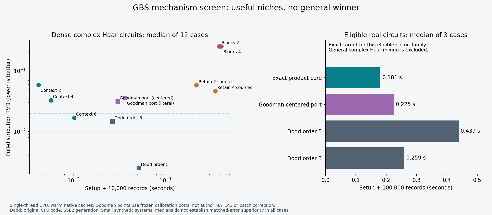

# Results: Detector-Context GBS Smoke Prototype

**Measured October 11, 2026; reorganized October 12.** These are synthetic CPU experiments with a smoke implementation. The cleanup did not generate new competitive measurements or change the probability model. Full data, failures, and comparison limitations remain available in [results/smoke_v1](results/smoke_v1/).

## Interpretation

The detector-context method has a measured niche: many records from a fixed circuit at a moderate permitted error. Its one-time exact-table compilation can be amortized across records. It is worth developing, but it is not a general accuracy winner and does not currently challenge a hardware-scale quantum-advantage claim.

Fifth-order Dodd is substantially more accurate on dense ten-mode circuits. The Goodman comparisons use disclosed equation ports rather than the original production sampler. Larger context timing probes have no matched full-distribution accuracy. A faster implementation could reduce overhead, but omitted-history error requires a representation or selection improvement.

## Test design and comparator status

The main suite contains **39 circuits × 11 methods = 429 completed comparisons**, with no failed rows: 36 complex-Haar circuits at 6, 8, and 10 modes, plus three ten-mode real-orthogonal controls. Complex circuits span transmission 0.3 and 0.5, heterogeneous sources, flat squeezing 0.7, brighter flat squeezing 1.0, and two seeds per setting. Heterogeneous sources use two strong squeezings, 0.8 and 0.65, with a 0.04–0.12 tail. The initial physical noise is photon loss only.

The main decision set has 24 eight- and ten-mode Haar circuits. Six-mode context six is a full-history exact control, so it is excluded from development-performance claims. At eight modes, six parents still use seven-mode marginals; that is near-global information.

| Comparator | What was actually measured |
| --- | --- |
| Dodd / FrugalGBS | Original pinned author C++ CPU generator at cumulant orders 3 and 5; forced-path scoring uses its marginal-update helpers and probability guards |
| Goodman | Python ports of threshold projection and ten moment-correction iterations; centered and literal moment conventions, each calibrated on 16,384 independent latent samples and then frozen |
| Goodman batch sensitivity | Separate per-output-batch correction ports; empirical scoring rather than exact fixed-law scoring |
| Oh | Our source-compression mechanism probe, **not** the published tensor-network implementation |
| Villalonga | Relevant prior work; its original generators were not executed in this suite |

Full threshold distributions from Gaussian no-click probabilities supply the small-system reference, with an independent complex-basis/Torontonian check. Candidate and Dodd induced laws are scored directly. Frozen Goodman laws use numerical integrations with two independent Sobol scramblings, initially 32,768 points each; 22 near-frontier rows were refined to 131,072 points each. Integration spread is a sensitivity diagnostic, not a certified confidence interval.

Primary error is

$$
\operatorname{TVD}(P,Q)=\frac12\sum_x |P(x)-Q(x)|.
$$

A TVD limit of 0.02 bounds the absolute difference assigned to any event by 0.02; it does not promise 2% relative accuracy for every outcome. Saved diagnostics also include click cumulants through order five, total and grouped click counts, click-sector conditional TVD, log cross entropy, and linear probability overlap. These are synthetic diagnostics, not reproduced experimental validation scores.

Timing uses one measured preparation plus the median of three record-generation repeats, rotating method order. Runs use one BLAS/OpenMP thread on a Ryzen 9 7950X. Native kernels are warm. Reference enumeration, installation, compilation, and interpreter startup are excluded; these are operational batch costs rather than complete cold-start costs.

## Dense ten-mode results

Medians across the 12 ten-mode complex-Haar circuits, including setup and 10,000 records:

| Method | Full TVD ↓ | Total seconds ↓ |
| --- | ---: | ---: |
| Dodd order 3 | 0.01465 | 0.02658 |
| Dodd order 5 | **0.00250** | 0.05163 |
| Goodman centered frozen port | 0.03131 | 0.03042 |
| Goodman literal frozen port | 0.03572 | 0.03632 |
| Context 2 | 0.05845 | **0.00418** |
| Context 4 | 0.03287 | 0.00571 |
| Context 6 | 0.01683 | 0.01019 |
| Retain 2 residual sources | 0.05792 | 0.21802 |
| Retain 4 residual sources | 0.04640 | 0.34936 |
| Gaussian blocks of 2 | 0.25524 | 0.38637 |
| Gaussian blocks of 4 | 0.25444 | 0.40591 |

Medians summarize different cells. The circuit-by-circuit common-tolerance comparison below is the stronger evidence.

## Common accuracy tolerance and batch size

For each circuit, compare with the fastest tested Dodd/frozen-Goodman method that also meets the same TVD limit. This means a common permitted error, not identical achieved errors.

| Candidate, 24 circuits | TVD ≤0.005: qualifies / faster | TVD ≤0.02: qualifies / faster | TVD ≤0.05: qualifies / faster |
| --- | ---: | ---: | ---: |
| Context 4 | 0 / 0 | 6 / 6 | 24 / 24 |
| Context 6 | 6 / 6 | **21 / 21** | 24 / 24 |
| Retain 2 sources | 1 / 0 | 8 / 0 | 11 / 0 |
| Retain 4 sources | 3 / 0 | 8 / 0 | 14 / 0 |
| Blocks 2 or 4 | 0 / 0 | 0 / 0 | 0 / 0 |

Context six gives a median **1.94× total-cost speedup** among its 21 qualifying cases at TVD ≤0.02. Three circuits fail that accuracy requirement. Its six successes at 0.005 are confined to near-global eight-mode contexts.

On six ten-mode Haar circuits at **100,000 records**, context six meets TVD ≤0.02 in all six and gives a median **17.53× speedup** against the fastest qualifying Dodd/frozen-port comparator. These cases reuse benchmark circuits; they add a workload measurement, not independent accuracy replication. The mechanism is amortization: fixed tables are cheap to reuse while alternatives continue doing more work per record.

The original relative “75%” screen required at least 75% of comparator throughput and no more than 1.25 times its TVD. Context six passed against Dodd order three in 19/24 cases, order five in **0/24**, and each frozen Goodman port in 24/24. This supports a moderate-error niche, not a prediction that routine polishing will overtake every competitor.

## Goodman workload sensitivity

The paper-style centered batch port has median total times **0.00222, 0.01170, and 0.21993 seconds** for 1,000, 10,000, and 100,000 records on the six bulk circuits. The literal port takes 0.00257, 0.01233, and 0.22087 seconds. Context setup can lose to this version for a small request.

Pooled histograms from three 100,000-record batches give median empirical TVDs 0.03617 and 0.03755. Exact-target IID histograms at that sample count can themselves have TVD around 0.022 in the brightest cell. These empirical estimates do not have the precision of the exact-law table and cannot certify a strict accuracy ranking. Transformation-dependent within-batch correlations are not ruled out.

## Other mechanisms: retained evidence

**Source compression.** Reducing residual squeezed-source rank decreases determinant dimensions, but the tested backend still expands over observed click history. The source mechanism can have good heterogeneous-circuit accuracy and remains slower here. It is not Oh's tensor-network algorithm and not a demonstrated polynomial-time sampler. A different backend would be a redesign.

**Generic small Gaussian blocks.** The dense Haar approximation needs substantial added covariance noise; measured TVD is around 0.255 and setup is expensive. This implementation does not justify further scaling in that regime. The added noise is an approximation repair, distinct from the experimental photon-loss model.

**Exact product core for an eligible structured family.** For real orthogonal mixing with aligned squeezing, define $a_j=1-\eta+\eta e^{-2r_j}$, $b_j=1-\eta+\eta e^{2r_j}$, and $a_*=\min_j a_j$. If $\min_j b_j\geq1/a_*$, then

$$
V_{\rm core}=\frac12\operatorname{diag}(a_*I_M,a_*^{-1}I_M),\qquad W=V-V_{\rm core}\succeq0.
$$

Sample correlated classical displacement with covariance $W$, then sample each displaced one-mode quantum core independently. Averaging over the shared displacement preserves correlations and the exact Gaussian target. This is a known separability construction in a restricted family, not general complex-Haar simulation or a cleared novel result.

On three ten-mode varying-squeezing cases (0.45–0.8; transmission 0.3, 0.4, 0.5), 100,000 records take **0.179–0.189 seconds**, versus order-five Dodd at **0.435–0.446 seconds** and centered frozen Goodman at **0.220–0.232 seconds**. Target TVD is zero by the covariance identity; a separate 200,000-record check has empirical TVD 0.01131, below the largest IID control of 0.01178. The analytical identity and sample-law check establish different parts of correctness.

## Scale, memory, and validity

At 32 modes, a complex-Haar timing probe takes 0.0584 seconds for context six versus 4.971 seconds for Dodd five, for setup plus 1,000 records. **There is no full-distribution accuracy comparison at this size.** A bounded 16-mode exhaustive-scoring attempt was stopped after about 235 CPU seconds; incomplete scores were discarded. The structured 32-mode product specialization is algebraically eligible and has promising timings, but concerns an easy restricted family and has no large-system numerical error certificate.

Isolated ten-mode workers peak at approximately **119 MiB for Dodd five, 164 MiB for centered Goodman, 152 MiB for context six, 231 MiB for source two, and 205 MiB for blocks two**, including a common Python/import baseline near 118 MiB. Context is not the lowest-RSS method. Dodd native persistent-array storage was uninstrumented; raw zero means missing, and the aggregate records it as null.

Author-code cumulants agree with the independent calculation to $1.90\times10^{-14}$. Vacuum and independent-mode limits pass. Sample-to-own-law checks are consistent with the saved IID controls. Context tables assert nonnegativity and normalization without clipping; source conditional guards report no measured excursions. Zero-support conditional rows remain a future instrumentation requirement.

The author Dodd CPU frontend uses native optimization, but generation uses an SSE2 bridge because AVX2/native-SIMD builds crashed on this Windows toolchain. This is an actual author-code comparison with a build limitation, not its best SIMD/GPU performance. Goodman port/language differences and absent Villalonga/Oh author implementations also preclude a general production ranking.

## Relevance to quantum advantage

The results demonstrate a classical sampling tradeoff on specified synthetic targets. If it remains useful as size increases, context compilation could lower classical costs used in an experimental advantage comparison. It could also expose which accessible detector statistics are reproducible with limited retained history.

To challenge a particular experiment, we must match its circuit, squeezing, loss, detector model, sample volume, fidelity requirements, and hardware/resource accounting. Passing selected cumulant or count checks is weaker than matching the full output law. A full-TVD result on ten modes does not certify thousands of modes, and the photon-loss-only model may omit experimentally relevant imperfections.

The preliminary conclusion is therefore **algorithm development is justified for a moderate-error, many-record niche**. A quantum-advantage disproof remains an unestablished, conditional longer-term outcome. [Proposal](Proposal.md) sets the next accuracy and comparator gates.

## Reproducibility

- [Raw main rows](results/smoke_v1/rows.jsonl), [aggregate](results/smoke_v1/summary.json), [fixed protocol](results/smoke_v1/protocol.json), and 39 `case_<seed>.npz` fixtures.
- [Accuracy refinement](results/smoke_v1/accuracy_refinement.json), [bulk supplement](results/smoke_v1/bulk.json), [batch sensitivity](results/smoke_v1/goodman_batch_check.json), [timing-only scale](results/smoke_v1/scale.json), and [memory](results/smoke_v1/memory.json).
- [Checks](results/smoke_v1/checks.json), [supplement checks](results/smoke_v1/supplement_checks.json), [environment](results/smoke_v1/environment.json), [execution notes](results/smoke_v1/execution_notes.json), and [packaging provenance](results/smoke_v1/packaging.json).
- [Code Description](Code%20Description.md) and [source](src/). Historical measurement metadata describes the original run; path changes and extracted unchanged functions are documented separately.

The [reorganization checks](results/smoke_v1/reorganization_checks.json) confirm identical saved context TVDs on all 39 fixtures, preservation of the measured data, and identical aggregate JSON recomputed from those data. This is a packaging verification, not a new benchmark. [Current snapshot checksums](results/manifest.json) cover the published documents, code, and measured artifacts.
